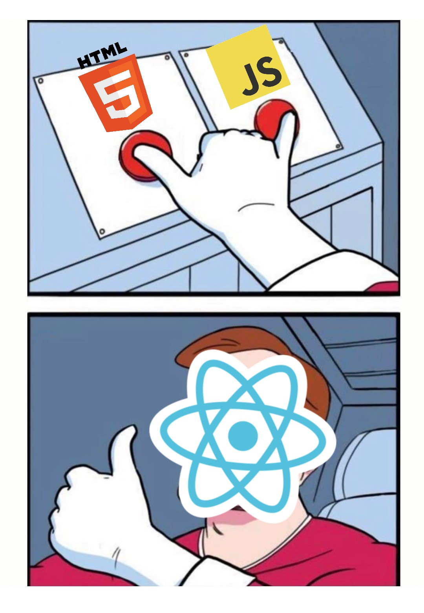
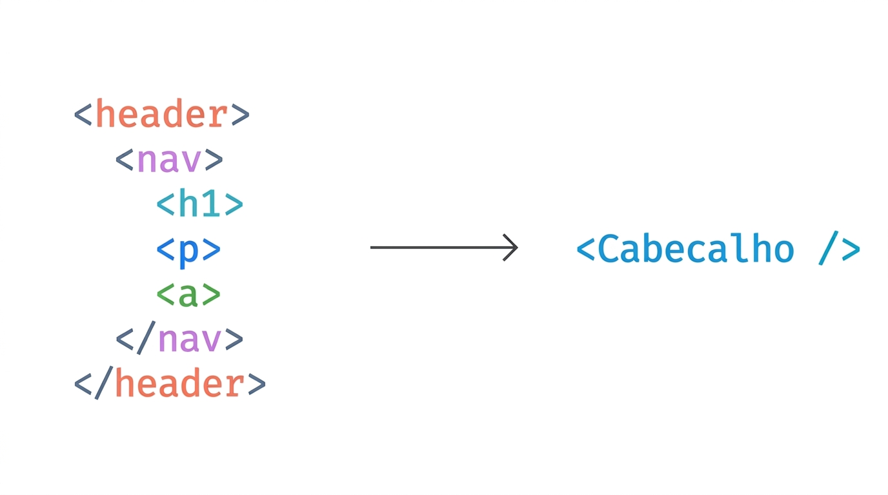
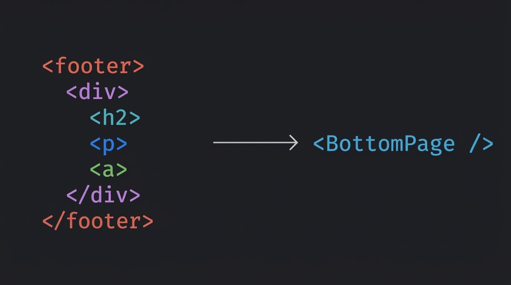
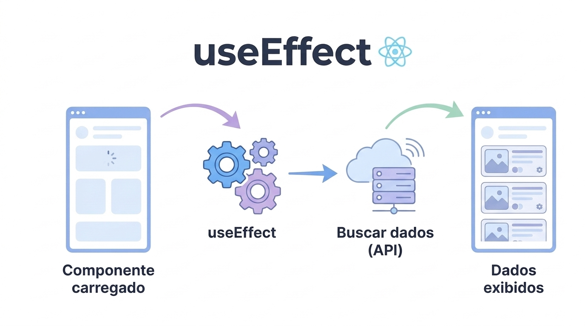

  
  

  

<strong>Português</strong>

 

Esse é um projeto que eu desenvolvi fazendo o curso do Matheus Battisti (Hora de Codar).No curso, dá pra aprender a linguagem react e muitos conceitos, como:

- o básico de React e como criar aplicações;
- modulação de arquivos e organização de pastas;
- criação dos seus próprios componentes, que funcionam como “tags” personalizadas, pra evitar repetição de código;
- como funciona um servidor, builds, deploys e segurança frontend e backend no geral;
- requisições GET, POST, PUT etc. no React;
- usar o npm pra instalar bibliotecas do ecossistema npm e aplicá-las no projeto;
- aprender a criar JSX, que é a mistura de JavaScript com HTML.

---

  

O React é uma biblioteca JavaScript usada para criar interfaces de sites e aplicações de forma dinâmica e organizada.
 
 
A ideia principal é juntar HTML + JavaScript = JSX, onde no JSX permite escrever uma estrutura parecida com HTML DENTRO do JavaScript, misturando a construção visual com a lógica da aplicação.
 
 

<strong>Além de funções essenciais como:</strong>

---

Componentes: Dividem a aplicação em pequenos blocos reutilizáveis, facilitando a organização e evitando repetição de código.

  
  
  

---

State (useState): representa a memória do componente, onde ele guarda informações, como nome, contador ou tema.

 
 

---

Hooks (useEffect): permitem executar ações em determinados momentos, como buscar dados de uma API quando um componente aparece.

 
 

---

React Rendering: representa o processo de criação e atualização da interface, exibindo os elementos na tela e refletindo mudanças de estado sem precisar recarregar a página.

 
 
 
 

---

Um gerenciador de finanças pessoais pra quem vive no limite do cartão (ou só quer parar de viver) e finalmente saber pra onde cada centavo foi.
 
 

O projeto conta com uma aba onde você registra os seus gastos, e pode adicionar ou remover na hora, sem planilha perdida.

Tudo fica salvo via API, então nada some quando você recarrega a página. (a não ser a versão online por segurança)

---

| # | Comando | Quando rodar | O que faz |
|:-:|---|---|---|
| 1 | `npm install` | Primeira vez ou após mudar o `package.json` | Instala as dependências do projeto |
| 2 | `npx concurrently "npm run dev" "npm run backend"` | Toda vez que for testar a aplicação | Sobe o frontend React/Vite e o backend simulado ao mesmo tempo |
| 3 | Abrir `http://localhost:5173` e `http://localhost:5234` | Após iniciar backend e frontend | Abre a aplicação no navegador e deixa a API disponível |

<strong>English</strong>

 

This is a project I built while taking Matheus Battisti's course (Hora de Codar). In the course, you get to learn the React language and many concepts, such as:

- the basics of React and how to create applications;
- file modularization and folder organization;
- creating your own components, which work like custom "tags", to avoid repeating code;
- how a server works, builds, deploys, and frontend and backend security in general;
- GET, POST, PUT, etc. requests in React;
- using npm to install libraries from the npm ecosystem and applying them to the project;
- learning to create JSX, which is the mix of JavaScript and HTML.

---

  

React is a JavaScript library used to build website and application interfaces in a dynamic, organized way.
 
 
The main idea is to combine HTML + JavaScript = JSX, where JSX lets you write an HTML-like structure INSIDE JavaScript, mixing the visual construction with the application logic.
 
 

<strong>Plus some essential functions like:</strong>

---

Components: They split the application into small reusable blocks, making organization easier and avoiding code repetition.

  
  
  

---

State (useState): it represents the component's memory, where it stores information such as a name, a counter, or a theme.

 
 

---

Hooks (useEffect): they let you run actions at specific moments, such as fetching data from an API when a component appears.

 
 

---

React Rendering: it represents the process of creating and updating the interface, displaying elements on the screen and reflecting state changes without reloading the page.

 
 
 
 

---

A personal finance manager for those who live right at the edge of their credit card limit (or just want to stop living like that) and finally find out where every cent went.
 
 

The project has a tab where you log your expenses, and you can add or remove them on the spot, with no lost spreadsheet.

Everything is saved through the API, so nothing disappears when you reload the page. (except for the online version, for security reasons)

---

| # | Command | When to run it | What it does |
|:-:|---|---|---|
| 1 | `npm install` | First time, or after changing `package.json` | Installs the project dependencies |
| 2 | `npx concurrently "npm run dev" "npm run backend"` | Every time you want to test the app | Starts the React/Vite frontend and the mock backend at the same time |
| 3 | Open `http://localhost:5173` and `http://localhost:5234` | After starting the backend and the frontend | Opens the app in the browser and makes the API available |

