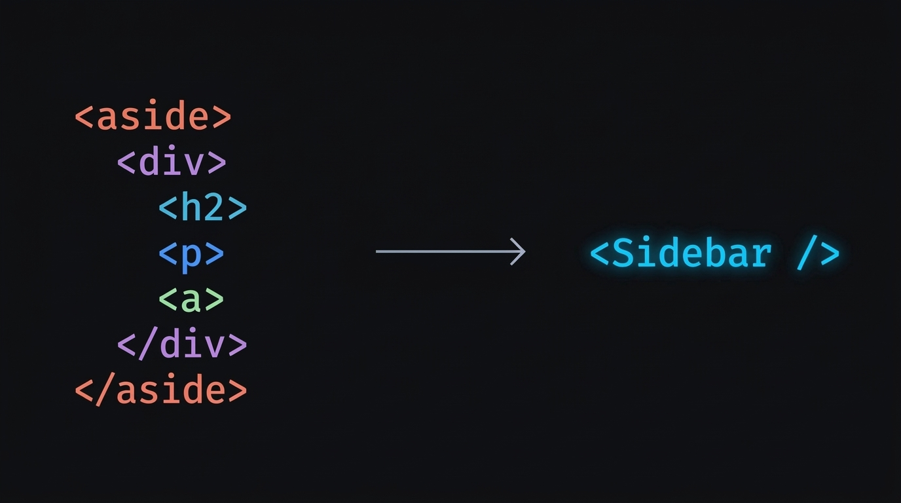
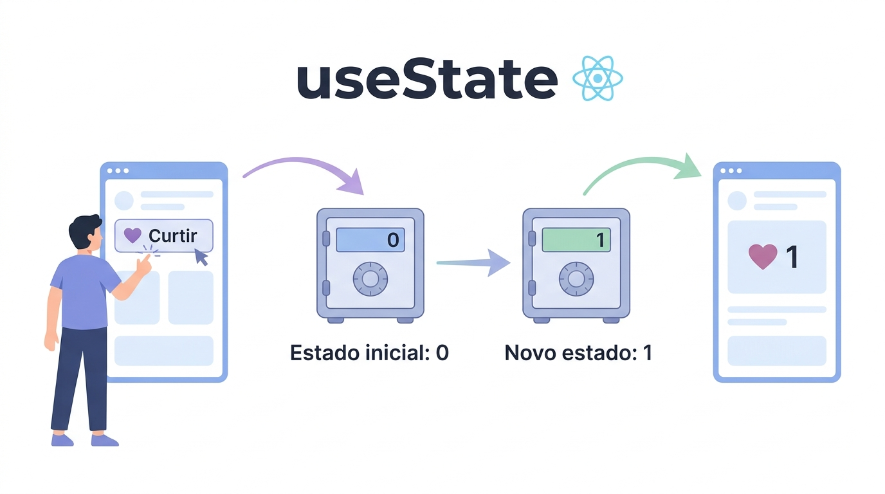

  
  

  

Esse é um projeto que eu desenvolvi fazendo o curso do Matheus Battisti (Hora de Codar).No curso, dá pra aprender a linguagem react e muitos conceitos, como:

- o básico de React e como criar aplicações;
- modulação de arquivos e organização de pastas;
- criação dos seus próprios componentes, que funcionam como “tags” personalizadas, pra evitar repetição de código;
- como funciona um servidor, builds, deploys e segurança frontend e backend no geral;
- requisições GET, POST, PUT etc. no React;
- usar o npm pra instalar bibliotecas do ecossistema npm e aplicá-las no projeto;
- aprender a criar JSX, que é a mistura de JavaScript com HTML.

---

  

O React é uma biblioteca JavaScript usada para criar interfaces de sites e aplicações de forma dinâmica e organizada.
 
 
A ideia principal é juntar HTML + JavaScript = JSX, onde no JSX permite escrever uma estrutura parecida com HTML DENTRO do JavaScript, misturando a construção visual com a lógica da aplicação.
 
 
 
 

---

Além de funções essenciais como:

Componentes: Dividem a aplicação em pequenos blocos reutilizáveis, facilitando a organização e evitando repetição de código.

  
  
  

Hooks & State Management: gerenciamento de estado, ciclo de vida e lógica dos componentes.

---

State (useState): representa a memória do componente, onde ele guarda informações, como nome, contador ou tema.

 
 
 
 

---

Hooks (useEffect): permitem executar ações em determinados momentos, como buscar dados de uma API quando um componente aparece.

 
 
 
 

---

State (useState): representa a memória do componente, onde ele guarda informações, como nome, contador ou tema.

 
 
 
 

Flexibilidade: pode ser integrado a projetos existentes, não sendo necessário construir uma aplicação inteira com React.

---

Um gerenciador de finanças pessoais pra quem vive no limite do cartão (ou só quer parar de viver) e finalmente saber pra onde cada centavo foi.
 
 

O projeto conta com uma aba onde você registra os seus gastos, e pode adicionar ou remover na hora, sem planilha perdida.

Tudo fica salvo via API, então nada some quando você recarrega a página. (a não ser a versão online por segurança)

---

| # | Comando | Quando rodar | O que faz |
|:-:|---|---|---|
| 1 | `npm install` | Primeira vez ou após mudar o `package.json` | Instala as dependências do projeto |
| 2 | `npx concurrently "npm run dev" "npm run backend"` | Toda vez que for testar a aplicação | Sobe o frontend React/Vite e o backend simulado ao mesmo tempo |
| 3 | Abrir `http://localhost:5173` e `http://localhost:5234` | Após iniciar backend e frontend | Abre a aplicação no navegador e deixa a API disponível |

---

